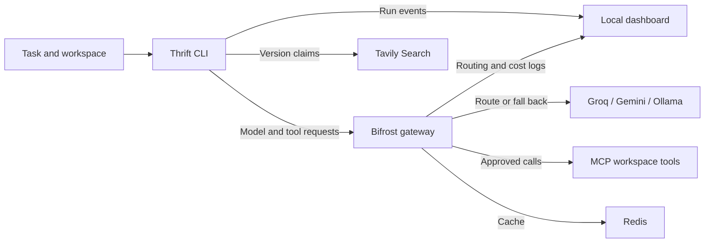

<h1 align="center">Thrift</h1>

<p align="center">
  <strong>A coding agent that spends fewer tokens on the fix.</strong>
</p>

<p align="center">
  Thrift is a terminal coding agent for Node.js repositories. It sends a compact context through
  Bifrost, checks version-sensitive API claims with Tavily, and asks before writes and shell commands.
  A local dashboard shows the model, tools and cost for each step.
</p>

<p align="center">
  
  
  
  
  
</p>

<p align="center">
  <a href="#results">Results</a> ·
  <a href="#the-four-hard-requirements">Requirements</a> ·
  <a href="#how-it-saves-tokens">How it works</a> ·
  <a href="#what-bifrost-does">Bifrost</a> ·
  <a href="#what-tavily-does">Tavily</a> ·
  <a href="#demo-scenarios">Demo</a> ·
  <a href="#running-it">Run it</a> ·
  <a href="#benchmark">Benchmark</a>
</p>

<p align="center">
  
</p>

## Results

On 17 shared tasks, Thrift used **68% fewer tokens per run**. Naive passed 24/24 valid runs and Thrift passed 31/31.

| Mode | Passed / valid runs | Avg tokens | Avg model cost | Avg time |
|---|---:|---:|---:|---:|
| naive | 24/24 | 11,126 | $0.00176 | 29.9 s |
| thrift | 31/31 | 3,579 | $0.00064 | 22.2 s |

The comparison pools the November 7 runs on tasks 01-06 and the November 9 runs on tasks 05-17. It reports means per valid run, so earlier tasks with more repeats carry more weight. Tasks 07-17 have one run per mode. If you average each task first and then average the 17 task means, naive comes to 10,878 tokens and Thrift to 4,931, which is 55% fewer. Thrift used fewer tokens on 15 of the 17 tasks. The benchmark excludes 8 attempts stopped by provider errors and omits 4 missing gateway costs from the cost averages. The earlier fallback and freshness experiments are recorded separately in the [journal](docs/journal.md). Thrift used more tokens on tasks 16 and 17. Both involved the freshness check, and task 17 also used more coding tokens.

### By difficulty

| Tier | Tasks | Naive pass | Naive avg tokens | Thrift pass | Thrift avg tokens |
|---|---:|---:|---:|---:|---:|
| Simple | 7 | 14/14 | 10,630 | 18/18 | 2,595 |
| Medium | 7 | 7/7 | 10,758 | 10/10 | 3,900 |
| Complex | 3 | 3/3 | 14,299 | 3/3 | 8,416 |

Reproduce the comparison with the source files:

```bash
cd agent
npm run summarize -- \
  ../bench/results/run-2026-11-07T06-17-12-387Z.jsonl \
  ../bench/results/run-2026-11-09T15-07-00-878Z.jsonl \
  ../bench/results/run-2026-11-09T15-28-44-567Z.jsonl \
  ../bench/results/run-2026-11-09T15-38-08-261Z.jsonl
```

## The four hard requirements

The problem statement lists four mandatory behaviors. This is where each one lives and how we tested it.

| Requirement | How Thrift does it | Evidence |
|---|---|---|
| Keep working through outages and rate limits, and tell the user | Every request carries a fallback chain (Groq, then Gemini, then local Ollama). When a fallback answers, the CLI prints which model took over and the run goes on with that model. | Fallback scene: Groq failed on step 1, Gemini finished the fix |
| Enforce individual spending limits before model calls | Each user gets a Bifrost virtual key with its own budget. Bifrost checks the budget before it forwards a request. On HTTP 402 the agent stops and says why. | Budget scene: step 2 got 402 and nothing else was sent |
| Confidential repos only go to local models | A repo marked with a `.thrift-private` file, or `"thrift": { "private": true }` in its `package.json`, always runs through the `thrift-private` key, which can only reach Ollama. The Tavily check is skipped. The marker is read from disk, so the task text cannot switch it off, and the baseline agent refuses to run on such a repo. | Private scene, plus a run whose task said to ignore privacy settings. Every step still went to qwen2.5-coder:7b |
| Reads are free, writes, shell and Git need approval | `list_files` and `read_file` run without asking. Every other tool call waits for a yes in the terminal, with a diff for file writes. The check happens in the CLI after the model answers, so a prompt cannot skip it. A "no" ends the run. | Approval scene: the denied `git push` never ran |

## Why

The benchmark baseline sends the full history to one model on every turn. Even a small fix can take separate turns to list files, read them, make an edit and run tests. Each turn sends the previous work back to the model.

Thrift sends relevant files in the first prompt and trims old tool output. It runs tests after an edit and stops when they pass, unless the task also requests Git actions.

## How it saves tokens

| Technique | Where | What it saves |
|---|---|---|
| Complexity routing | Bifrost complexity analyzer + CEL routing rules | Simple tasks run on gpt-oss-20b instead of gpt-oss-120b |
| One routing decision per task | `agent/src/index.ts` | The gateway classifies the task message. Later steps stay on the responding model. |
| Context up front | `agent/src/context.ts` | Relevant files ranked and sent in the first prompt, no list and read round trips |
| History trimming | `agent/src/context.ts` | Old tool output becomes a one line stub, and a file's old copy is dropped once the model writes a new one |
| Agent runs the tests | `agent/src/index.ts` | Thrift runs `npm test` after an edit and can stop without another model call. |
| Semantic cache | Bifrost `semantic_cache` plugin on Redis | Repeated requests can reuse cached responses. Each benchmark attempt uses a separate cache key. |

## What Bifrost does

Every model call and every tool call goes through the gateway.

| Feature | How Thrift uses it |
|---|---|
| Complexity router | Tags each task SIMPLE, MEDIUM or COMPLEX with local embeddings (`nomic-embed-text` on Ollama). Routing rules pick the model per tier |
| Fallbacks | Each tier has its own chain: Groq, then Gemini, then local Ollama. If a provider rate limits or goes down mid task, the request moves on and the agent keeps working |
| MCP with manual execution | Workspace tools (read, write, list, run) come from our stdio MCP server through Bifrost. Bifrost returns tool calls, the agent executes them, so risky ones can be confirmed first |
| Virtual keys and budgets | `thrift-dev` has a daily budget, `thrift-private` can only reach Ollama, `thrift-baseline` is the naive agent. When a budget runs out the gateway answers 402 and the agent stops cleanly |
| Semantic cache | Redis backed, one namespace per run in the benchmark so runs don't share answers |
| Logs and cost | `/api/logs` gives cost, tier and routing rule per request. The benchmark and the dashboard read them |

## What Tavily does

Library syntax can change between major versions. For example, `app.all('/api/*')` throws on Express 5 because the wildcard needs a name. [Express 5 migration guide](https://expressjs.com/en/guide/migrating-5/#path-route-matching-syntax)

Before the first coding step, Thrift:

1. reads the installed package versions from `node_modules`,
2. asks a small model which facts about those versions the task depends on,
3. checks each one with a Tavily search,
4. scores each claim as outdated (0), unknown (0.5) or current (1), and adds supported corrections to the context.

Repos without dependencies skip the check and pay nothing. Private mode skips it too, so the task never leaves the machine.

### Checking any answer

The same verification step works on its own. Give it an answer that any LLM wrote and it pulls out the claims that can go stale (prices, versions and API behavior, laws, company leadership), searches each one with Tavily, and scores it. The claim extraction and the judge both run through Bifrost on the small model.

```bash
cd agent
set -a; . ../.env; set +a
npm run check -- answer.txt          # or: pbpaste | npm run check
npm run check -- answer.txt --json   # verdicts, sources, token count
```

On a sample answer that recommended Zod 3, the old Express wildcard, Node.js 18 as the current LTS and an old GPT-4 Turbo price, it marked Zod 3 as outdated with a link to the Zod releases page and found a source for the price. Node.js 18 and Express stayed unknown because the excerpts it got back had no quote that settled them. A verdict only counts when the judge quotes an excerpt from the URL it cites, so a weak search gives "unknown", not a guess.

### Freshness results

The November 9 rerun used the stricter evidence check on tasks 15-17. Both modes passed 9/9. Stale is Thrift with freshness disabled.

| Task | Stale pass | Thrift pass | Stale avg tokens | Thrift avg tokens |
|---|---:|---:|---:|---:|
| 15-zod-signup-errors | 3/3 | 3/3 | 3,129 | 5,490 |
| 16-express-api-404 | 3/3 | 3/3 | 4,171 | 8,469 |
| 17-express-files-path | 3/3 | 3/3 | 12,958 | 16,205 |
| All | 9/9 | 9/9 | 6,753 | 10,054 |

The check ran 15 successful searches across 5 of 9 thrift runs. The judge accepted 6 claims as current and left 9 unknown. It added no corrections in this batch. Freshness calls averaged 3,513 tokens per thrift run. There was no pass-rate gain, and checking the evidence increased token use. One stale run fell back to Gemini, so the recorded cost gap also reflects provider choice.

See the [freshness dashboard](docs/demo/bench.png) and [raw runs](bench/results/run-2026-11-09T14-53-34-479Z.jsonl).

## Demo scenarios

Each scene below was recorded on the live dashboard. The numbers are from those single runs, not averages.

| Scene | What happened |
|---|---|
| Fallback | Task 01 (percent coupon). Groq failed on step 1, so Bifrost answered with gemini-3.5-flash-lite. The agent pinned that model for step 2, which wrote the fix. 2,709 tokens, $0.00097, 2 steps |
| Budget | A run on the booking ranges task with a tiny budget on the virtual key. Step 1 went through on gpt-oss-120b, step 2 got a 402 "Budget exceeded" from the gateway and the agent stopped cleanly |
| Private | Task 02 (pagination) with `--private`. One step on qwen2.5-coder:7b through the `thrift-private` key, 973 tokens, $0 |
| Approval | The task asked for `git add`, `git commit` and `git push origin main`. Each command waited for a yes or no. With push approved the run took 4 steps and 3,984 tokens. With push denied the agent stopped at that point (3 steps, 2,874 tokens, $0.00023) |

<p align="center">
  
  
</p>
<p align="center">
  
  
</p>

The terminal output of both approval runs is in `docs/demo/approval-approve.txt` and `docs/demo/approval-deny.txt`.


## Architecture



| Part | Path | Role |
|---|---|---|
| Agent | `agent/src/index.ts` | Loop, routing pin, approval prompts, auto test run, events |
| Context | `agent/src/context.ts` | File ranking, repo context, history trimming |
| Freshness check | `agent/src/freshness.ts` | Claim extraction, Tavily lookup, scoring |
| Answer checker | `agent/src/check.ts` | Runs the same check on any LLM answer from a file or stdin |
| Gateway client | `agent/src/gateway.ts` | One chat call through Bifrost, with routing and usage headers |
| Workspace tools | `agent/src/workspace-server.ts` | Stdio MCP server with read, write, list and run |
| Benchmark | `agent/src/bench.ts`, `agent/src/summarize.ts`, `bench/` | Runner, summary, 17 tasks with reference solutions |
| Gateway config | `bifrost/config.template.json`, `scripts/gateway.sh` | Providers, keys, budgets, routing rules, cache, MCP |
| Dashboard | `dashboard/` | Live run view and benchmark results |

## Running it

You need Node.js 22, Docker (for Redis) and Ollama with `qwen2.5-coder:7b` and `nomic-embed-text`.

```bash
cp .env.example .env
```

Fill in the keys. Start Docker Desktop and Ollama (use `ollama serve` if Ollama is not running), then run these commands from the repo root:

```bash
docker compose up -d
```

```bash
ollama pull qwen2.5-coder:7b && ollama pull nomic-embed-text
```

```bash
npm ci --prefix agent
npm ci --prefix dashboard
mkdir -p sandbox/demo-app
cp -R bench/tasks/01-cart-coupon/repo/. sandbox/demo-app/
```

```bash
scripts/gateway.sh --fresh
```

The gateway UI is at http://localhost:8080. Start the dashboard in a separate terminal:

```bash
npm run dev --prefix dashboard
```

Open the local URL printed by Vite to watch the run (usually http://localhost:5173). In another terminal, run the task against the copy of the cart fixture:

```bash
cd agent
set -a; . ../.env; set +a
npm start -- "Prices come out wrong when a percent coupon is applied at checkout. Fix it."
```

Flags: `--private` keeps everything on Ollama, `--naive` runs the baseline agent, `--yes` approves every action, `--no-fresh` turns off the Tavily check. To mark a repo as confidential for good, add an empty `.thrift-private` file to it. Thrift then uses private mode whether or not you pass the flag.

To work on another checkout, set `THRIFT_WORKSPACE` in `.env` to its path. Relative paths start from the Thrift repo root. Restart the gateway with `scripts/gateway.sh --fresh` after changing workspaces. This resets the local Bifrost databases. Use the default workspace for the benchmark.

After moving the Thrift checkout, `scripts/gateway.sh --config-only` rewrites the generated MCP paths without touching the running gateway or its databases.

### Environment

| Variable | Needed | Purpose |
|---|---|---|
| `GROQ_API_KEY` | yes | gpt-oss-20b and gpt-oss-120b |
| `GEMINI_API_KEY` | yes | Fallback models |
| `TAVILY_API_KEY` | for the freshness check | Web lookups |
| `BIFROST_SETUP_TOKEN` | yes | Admin API access for logs and cost |
| `THRIFT_VK_DEV`, `THRIFT_VK_PRIVATE`, `THRIFT_VK_BASELINE` | yes | Virtual key values, any random strings |
| `THRIFT_WORKSPACE` | optional | Workspace for the CLI and MCP server, defaults to `sandbox/demo-app` |

## Benchmark

There are 17 small Node repos with failing tests in `bench/tasks/` (7 simple, 7 medium and 3 complex). Three tasks depend on current library versions. Every task has a reference solution in `bench/solutions/` and was checked to fail before and pass after it. The runner restores protected test files before judging.

| Mode | What it is |
|---|---|
| `naive` | One model (gpt-oss-120b), no context up front, full history every step |
| `thrift` | Everything above |
| `stale` | Thrift with the freshness check off |

```bash
cd agent
set -a; . ../.env; set +a
npm run bench -- --runs 3
```

```bash
npm run bench -- --only 15,16,17 --modes stale,thrift --runs 3
npm run summarize -- ../bench/results/<file>.jsonl
```

The runner replaces the contents of `sandbox/demo-app` for each attempt. Keep your own files outside it. Each batch writes a new JSONL file in `bench/results/`. Pass multiple JSONL paths to `summarize` to combine batches from the same experiment.

See [docs/journal.md](docs/journal.md) for the run history.

## Team

anakshin power
