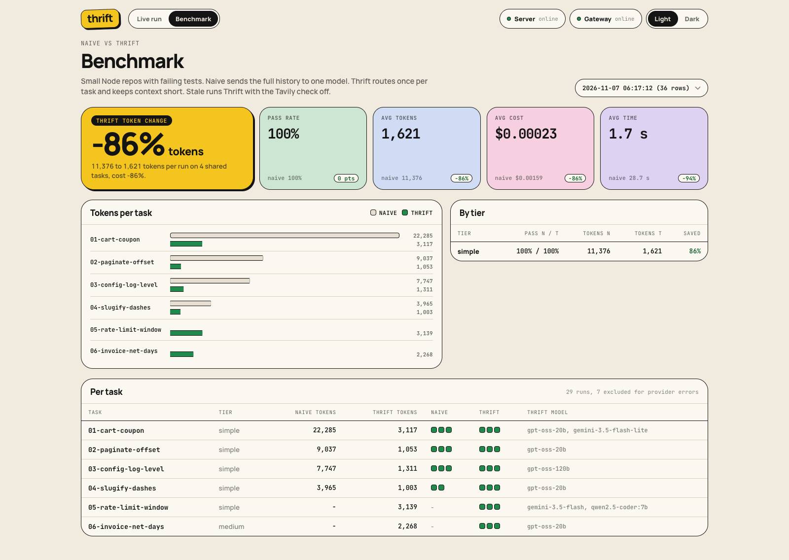
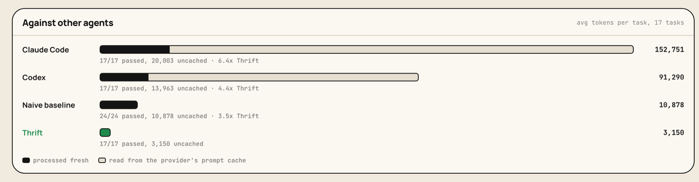
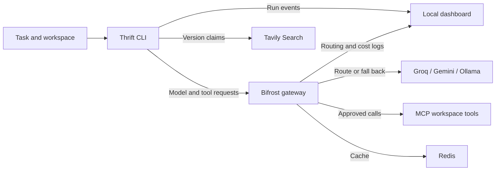

<h1 align="center">Thrift</h1>

<p align="center">
  <strong>A coding agent that spends fewer tokens on the fix.</strong>
</p>

<p align="center">
  Thrift is a terminal coding agent for Node.js repositories. It sends a compact context through
  Bifrost, checks version-sensitive API claims with Tavily, and asks before writes and shell commands.
  A local dashboard shows the model, tools and cost for each step.
</p>

<p align="center">
  
  
  
  
  
</p>

<p align="center">
  <a href="#results">Results</a> ·
  <a href="#the-four-hard-requirements">Requirements</a> ·
  <a href="#how-it-saves-tokens">How it works</a> ·
  <a href="#what-bifrost-does">Bifrost</a> ·
  <a href="#what-tavily-does">Tavily</a> ·
  <a href="#demo-scenarios">Demo</a> ·
  <a href="#running-it">Run it</a> ·
  <a href="#benchmark">Benchmark</a>
</p>

<p align="center">
  
</p>

## Results

On the 17 benchmark tasks, Thrift passed **17/17** with an average of **3,150 tokens per task**. The naive baseline needed 10,878, so Thrift used **71% fewer tokens**. It was cheaper on 15 of the 17 tasks.

| Agent | Passed | Avg tokens per task | Avg model cost | Avg time |
|---|---:|---:|---:|---:|
| naive (full history, one model) | 24/24 valid runs | 10,878 | $0.00182 | 29.9 s |
| Thrift | 17/17 | 3,150 | $0.00132 | 27.0 s |

Each task is averaged first, then the 17 task means are averaged, so tasks with more repeats don't count extra. Averaged per run instead, as the dashboard does, it is 11,126 against 3,150, 72% fewer. Fourteen tasks finished in a single model call. The two tasks where Thrift spent more than naive are 16 and 17, which run the Tavily check: the coding part alone came to 3,495 and 11,570 tokens, under naive on both, and the check's 3,379 and 4,858 tokens put it over. The cost gap is smaller than the token gap because Groq's daily quota for the small model ran out during the run and 16 calls fell back to Gemini, which costs more per token.

The Thrift numbers come from one run per task on November 11, after the [`write_files` change](#how-it-saves-tokens). The naive runs are the recorded ones from November 7 and 9. The naive agent and its tools did not change between them. The first Thrift suite, before `write_files`, averaged 4,931 tokens per task (55% fewer than naive) with 31/31 passes. Its files are listed in [paired-suite.json](bench/results/paired-suite.json).

### By difficulty

| Tier | Tasks | Naive avg tokens | Thrift avg tokens | Change |
|---|---:|---:|---:|---:|
| Simple | 7 | 9,531 | 3,063 | -68% |
| Medium | 7 | 10,758 | 3,665 | -66% |
| Complex | 3 | 14,299 | 2,151 | -85% |

The complex tasks gained the most from `write_files`. They touch several files, and with one write per reply each extra file cost a full round trip.

### Against Codex and Claude Code

We also ran the two agents most people use on the same 17 tasks with `npm run compare`: Codex CLI (the agent in ChatGPT, gpt-6.1-sol at low reasoning effort) and Claude Code (Opus 5.5). Each attempt got a fresh copy of the fixture with approvals off, and `npm test` on the restored tests decided pass or fail. Token counts are what each agent reports about itself.

| Agent | Passed | Avg tokens per task | Read from prompt cache | Uncached tokens |
|---|---:|---:|---:|---:|
| Claude Code | 17/17 | 152,751 | 132,748 | 20,003 |
| Codex | 17/17 | 91,290 | 77,327 | 13,963 |
| Thrift | 17/17 | 3,150 | 0 | 3,150 |



All three solved every task. Most of what the other two read is their own system prompt and tool definitions, which the provider caches and bills at a discount. So the fairer line is uncached tokens (new input, cache writes and output): Claude Code used 6.4 times as many as Thrift and Codex 4.4 times as many. Thrift was lower than Claude Code on all 17 tasks and lower than Codex on 16. Asked only to reply "ok", Claude Code still wrote about 39,000 tokens of setup into the cache.

The models differ, so this compares the agents as you would use them, not the models behind them. One run per task. Raw runs: [Claude Code](bench/results/run-2026-11-11T16-08-13-430Z.jsonl), [Codex](bench/results/run-2026-11-11T15-05-14-608Z.jsonl).

Reproduce the comparison with the source files:

```bash
cd agent
npm run summarize -- ../bench/results/run-2026-11-11T15-00-30-224Z.jsonl
npm run summarize -- \
  ../bench/results/run-2026-11-07T06-17-12-387Z.jsonl \
  ../bench/results/run-2026-11-09T15-07-00-878Z.jsonl \
  ../bench/results/run-2026-11-09T15-28-44-567Z.jsonl \
  ../bench/results/run-2026-11-09T15-38-08-261Z.jsonl
```

## The four hard requirements

The problem statement lists four mandatory behaviors. This is where each one lives and how we tested it.

| Requirement | How Thrift does it | Evidence |
|---|---|---|
| Keep working through outages and rate limits, and tell the user | Every request carries a fallback chain (Groq, then Gemini, then local Ollama). When a fallback answers, the CLI prints which model took over and the run goes on with that model. If every model in the chain fails, the CLI says so, waits (5, 15, 30, then 60 seconds) and tries again. If that also fails, it saves the run to `.thrift/session.json` and `npm start -- --resume` picks it up at the next step. | Fallback scene: Groq failed on step 1, Gemini finished the fix. CLI tests cover the retry after a 503 and a resume after an outage |
| Enforce individual spending limits before model calls | Each user gets a Bifrost virtual key with its own budget. Bifrost checks the budget before it forwards a request. On HTTP 402 the agent stops, says the key's limit is reached and keeps the run for `--resume`. It does not retry a 402. | Budget scene: step 2 got 402 and nothing else was sent |
| Confidential repos only go to local models | A repo marked with a `.thrift-private` file, or `"thrift": { "private": true }` in its `package.json`, always runs through the `thrift-private` key, which can only reach Ollama. The Tavily check is skipped. The marker is read from disk, so the task text cannot switch it off, and the baseline agent refuses to run on such a repo. | Private scene, plus a run whose task said to ignore privacy settings. Every step still went to qwen2.5-coder:7b |
| Reads are free, writes, shell and Git need approval | `list_files` and `read_file` run without asking. Every other tool call waits for a yes in the terminal, with a diff for file writes. The check happens in the CLI after the model answers, so a prompt cannot skip it. A "no" or a closed input ends the run. | Approval scene: the denied `git push` never ran. A CLI test checks that a declined write never reaches the MCP server |

## Why

The benchmark baseline sends the full history to one model on every turn. Even a small fix can take separate turns to list files, read them, make an edit and run tests. Each turn sends the previous work back to the model.

Thrift sends relevant files in the first prompt and trims old tool output. It runs tests after an edit and stops when they pass, unless the task also requests Git actions.

## How it saves tokens

| Technique | Where | What it saves |
|---|---|---|
| Complexity routing | Bifrost complexity analyzer + CEL routing rules | Simple tasks run on gpt-oss-20b instead of gpt-oss-120b |
| One routing decision per task | `agent/src/index.ts` | The gateway classifies the task message. Later steps stay on the responding model. |
| Context up front | `agent/src/context.ts` | Relevant files ranked and sent in the first prompt, no list and read round trips |
| History trimming | `agent/src/context.ts` | Old tool output becomes a one line stub, and a file's old copy is dropped once the model writes a new one |
| Agent runs the tests | `agent/src/index.ts` | Thrift runs `npm test` after an edit and can stop without another model call. |
| All edits in one call | `write_files` in `agent/src/workspace-server.ts` | gpt-oss on Groq returns one tool call per reply, so a three-file fix took three round trips, each resending the context. Thrift's key gets a tool that writes every file at once. On the rename task this took 11,410 tokens in 4 steps down to 2,289 in 1. |
| Semantic cache | Bifrost `semantic_cache` plugin on Redis | Repeated requests can reuse cached responses. Each benchmark attempt uses a separate cache key. |

## What Bifrost does

Every model call and every tool call goes through the gateway.

| Feature | How Thrift uses it |
|---|---|
| Complexity router | Tags each task SIMPLE, MEDIUM or COMPLEX with local embeddings (`nomic-embed-text` on Ollama). Routing rules pick the model per tier |
| Fallbacks | Each tier has its own chain: Groq, then Gemini, then local Ollama. If a provider rate limits or goes down mid task, the request moves on and the agent keeps working |
| MCP with manual execution | Workspace tools (read, write, list, run) come from our stdio MCP server through Bifrost. Bifrost returns tool calls, the agent executes them, so risky ones can be confirmed first |
| Virtual keys and budgets | Each key also lists its MCP tools: `thrift-dev` gets `write_files`, the baseline and private keys keep `write_file`. `thrift-dev` has a daily budget, `thrift-private` can only reach Ollama, `thrift-baseline` is the naive agent. When a budget runs out the gateway answers 402 and the agent stops cleanly |
| Semantic cache | Redis backed, one namespace per run in the benchmark so runs don't share answers |
| Logs and cost | `/api/logs` gives cost, tier and routing rule per request. The benchmark and the dashboard read them |

## What Tavily does

Library syntax can change between major versions. For example, `app.all('/api/*')` throws on Express 5 because the wildcard needs a name. [Express 5 migration guide](https://expressjs.com/en/guide/migrating-5/#path-route-matching-syntax)

Before the first coding step, Thrift:

1. reads the installed package versions from `node_modules`,
2. asks a small model which facts about those versions the task depends on,
3. checks each one with a Tavily search,
4. scores each claim as outdated (0), unknown (0.5) or current (1), and adds supported corrections to the context.

Repos without dependencies skip the check and pay nothing. Private mode skips it too, so the task never leaves the machine.

### Checking any answer

The same verification step works on its own. Give it an answer that any LLM wrote and it pulls out the claims that can go stale (prices, versions and API behavior, laws, company leadership), searches each one with Tavily, and scores it. The claim extraction and the judge both run through Bifrost on the small model.

```bash
cd agent
set -a; . ../.env; set +a
npm run check -- answer.txt          # or: pbpaste | npm run check
npm run check -- answer.txt --json   # verdicts, sources, token count
```

On a sample answer that recommended Zod 3, the old Express wildcard, Node.js 18 as the current LTS and an old GPT-4 Turbo price, it marked Zod 3 as outdated with a link to the Zod releases page and found a source for the price. Node.js 18 and Express stayed unknown because the excerpts it got back had no quote that settled them. A verdict only counts when the judge quotes an excerpt from the URL it cites, so a weak search gives "unknown", not a guess.

### Freshness results

The November 9 rerun used the stricter evidence check on tasks 15-17. Both modes passed 9/9. Stale is Thrift with freshness disabled.

| Task | Stale pass | Thrift pass | Stale avg tokens | Thrift avg tokens |
|---|---:|---:|---:|---:|
| 15-zod-signup-errors | 3/3 | 3/3 | 3,129 | 5,490 |
| 16-express-api-404 | 3/3 | 3/3 | 4,171 | 8,469 |
| 17-express-files-path | 3/3 | 3/3 | 12,958 | 16,205 |
| All | 9/9 | 9/9 | 6,753 | 10,054 |

The check ran 15 successful searches across 5 of 9 thrift runs. The judge accepted 6 claims as current and left 9 unknown. It added no corrections in this batch. Freshness calls averaged 3,513 tokens per thrift run. There was no pass-rate gain, and checking the evidence increased token use. One stale run fell back to Gemini, so the recorded cost gap also reflects provider choice.

See the [freshness dashboard](docs/demo/bench.png) and [raw runs](bench/results/run-2026-11-09T14-53-34-479Z.jsonl).

### Stale-claim accuracy

The coding tasks above say little about the detector itself, because the model often solved them without the check. So we built a labeled set: [30 claims](bench/stale/claims.json) about API behavior, versions, prices, company leadership and laws, 16 of them out of date in November 2026 and 14 still true. Where we were not sure of the answer ourselves we looked it up first.

`npm run stale-eval` sends every claim to the same small model twice. Once it answers from memory. Once it gets Tavily excerpts and has to quote one of them. These are the two runs with the current settings (v3):

| Judge | Right | Stale caught | Stale passed as current | False alarms | Unknown | Tokens per claim |
|---|---:|---:|---:|---:|---:|---:|
| Memory only | 18/30 | 9/16 | 3/16 | 1/14 | 8 | 375 |
| Tavily, run 1 | 26/30 | 15/16 | 0/16 | 0/14 | 4 | 1,767 |
| Tavily, run 2 | 27/30 | 15/16 | 0/16 | 0/14 | 3 | 1,801 |

The worst mistake a detector can make is to call a stale claim current. Across all five memory runs the model did that 21 times out of 80. Across every Tavily run, including the weaker settings we tried before v3, it happened 0 times out of 80, and no current claim was flagged as stale (0 of 70). When the evidence is thin the answer is "unknown". The claims left unknown were the Express 5 wildcard, Moment.js maintenance mode, the Lambda free tier and once node-fetch.

Getting there took four versions, all kept in [bench/stale/results](bench/stale/results). v1 judged every claim in one call and matched the cited URL exactly, which threw away right answers when the URL lost its query string. v2 matched the quote against all excerpts instead. v3 gives each claim its own judge call at temperature 0. v4 also set low reasoning effort on the judge and dropped to 22/30, so only claim extraction keeps that setting.

```bash
npm run stale-eval                      # memory and tavily
npm run stale-eval -- --modes tavily    # tavily only
```

Settled verdicts and claim lists are cached in `.thrift/freshness-cache.json` for 7 days, so a second run on the same dependencies skips the searches and the judge. `THRIFT_FRESHNESS_CACHE=off` turns this off, and the benchmark keeps it off so every attempt pays the full cost.

## Demo scenarios

Each scene below was recorded on the live dashboard. The numbers are from those single runs, not averages.

| Scene | What happened |
|---|---|
| Fallback | Task 01 (percent coupon). Groq failed on step 1, so Bifrost answered with gemini-3.5-flash-lite. The agent pinned that model for step 2, which wrote the fix. 2,709 tokens, $0.00097, 2 steps |
| Budget | A run on the booking ranges task with a tiny budget on the virtual key. Step 1 went through on gpt-oss-120b, step 2 got a 402 "Budget exceeded" from the gateway and the agent stopped cleanly |
| Private | Task 02 (pagination) with `--private`. One step on qwen2.5-coder:7b through the `thrift-private` key, 973 tokens, $0 |
| Approval | The task asked for `git add`, `git commit` and `git push origin main`. Each command waited for a yes or no. With push approved the run took 4 steps and 3,984 tokens. With push denied the agent stopped at that point (3 steps, 2,874 tokens, $0.00023) |

<p align="center">
  
  
</p>
<p align="center">
  
  
</p>

The terminal output of both approval runs is in `docs/demo/approval-approve.txt` and `docs/demo/approval-deny.txt`.


## Architecture



| Part | Path | Role |
|---|---|---|
| Agent | `agent/src/index.ts` | Loop, routing pin, approval prompts, auto test run, events |
| Context | `agent/src/context.ts` | File ranking, repo context, history trimming |
| Freshness check | `agent/src/freshness.ts` | Claim extraction, Tavily lookup, scoring |
| Answer checker | `agent/src/check.ts` | Runs the same check on any LLM answer from a file or stdin |
| Stale-claim eval | `agent/src/stale-eval.ts`, `bench/stale/` | Labeled claims, memory vs Tavily judge |
| Policy | `agent/src/policy.ts` | Confidential marker, approval rule, retry delays |
| Sessions and cache | `agent/src/session.ts`, `agent/src/cache.ts` | Saved runs for `--resume`, freshness cache |
| Gateway client | `agent/src/gateway.ts` | One chat call through Bifrost, with routing and usage headers |
| Workspace tools | `agent/src/workspace-server.ts` | Stdio MCP server with read, write, list and run |
| Tests | `agent/test/` | Unit tests and CLI tests against a mock gateway |
| Benchmark | `agent/src/bench.ts`, `agent/src/summarize.ts`, `bench/` | Runner, summary, 17 tasks with reference solutions |
| Gateway config | `bifrost/config.template.json`, `scripts/gateway.sh` | Providers, keys, budgets, routing rules, cache, MCP |
| Dashboard | `dashboard/` | Live run view and benchmark results |

## Running it

You need Node.js 22, Docker (for Redis) and Ollama with `qwen2.5-coder:7b` and `nomic-embed-text`.

```bash
cp .env.example .env
```

Fill in the keys. Start Docker Desktop and Ollama (use `ollama serve` if Ollama is not running), then run these commands from the repo root:

```bash
docker compose up -d
```

```bash
ollama pull qwen2.5-coder:7b && ollama pull nomic-embed-text
```

```bash
npm ci --prefix agent
npm ci --prefix dashboard
mkdir -p sandbox/demo-app
cp -R bench/tasks/01-cart-coupon/repo/. sandbox/demo-app/
```

```bash
scripts/gateway.sh --fresh
```

The gateway UI is at http://localhost:8080. Start the dashboard in a separate terminal:

```bash
npm run dev --prefix dashboard
```

Open the local URL printed by Vite to watch the run (usually http://localhost:5173). In another terminal, run the task against the copy of the cart fixture:

```bash
cd agent
set -a; . ../.env; set +a
npm start -- "Prices come out wrong when a percent coupon is applied at checkout. Fix it."
```

Flags: `--private` keeps everything on Ollama, `--naive` runs the baseline agent, `--yes` approves every action, `--no-fresh` turns off the Tavily check, `--resume` continues a run that stopped on an outage or a spent budget. To mark a repo as confidential for good, add an empty `.thrift-private` file to it. Thrift then uses private mode whether or not you pass the flag.

To work on another checkout, set `THRIFT_WORKSPACE` in `.env` to its path. Relative paths start from the Thrift repo root. Restart the gateway with `scripts/gateway.sh --fresh` after changing workspaces. This resets the local Bifrost databases. Use the default workspace for the benchmark.

After moving the Thrift checkout, `scripts/gateway.sh --config-only` rewrites the generated MCP paths without touching the running gateway or its databases.

### Tests

```bash
npm test --prefix agent
```

The unit tests cover the approval rule, retry delays, the private marker, saved sessions, history trimming, the quote check and parallel cache writes. The CLI tests start the real agent against a small mock gateway and check the fallback notice, the retry after a 503, save and resume, the 402 stop, private mode on a marked repo, a declined write, `write_files` and broken tool arguments. They need no API keys.

### Environment

| Variable | Needed | Purpose |
|---|---|---|
| `GROQ_API_KEY` | yes | gpt-oss-20b and gpt-oss-120b |
| `GEMINI_API_KEY` | yes | Fallback models |
| `TAVILY_API_KEY` | for the freshness check | Web lookups |
| `BIFROST_SETUP_TOKEN` | yes | Admin API access for logs and cost |
| `THRIFT_VK_DEV`, `THRIFT_VK_PRIVATE`, `THRIFT_VK_BASELINE` | yes | Virtual key values, any random strings |
| `THRIFT_WORKSPACE` | optional | Workspace for the CLI and MCP server, defaults to `sandbox/demo-app` |

## Benchmark

There are 17 small Node repos with failing tests in `bench/tasks/` (7 simple, 7 medium and 3 complex). Three tasks depend on current library versions. Every task has a reference solution in `bench/solutions/` and was checked to fail before and pass after it. The runner restores protected test files before judging.

| Mode | What it is |
|---|---|
| `naive` | One model (gpt-oss-120b), no context up front, full history every step |
| `thrift` | Everything above |
| `stale` | Thrift with the freshness check off |
| `thrift-no-*` | Thrift with one technique off, see below |

```bash
cd agent
set -a; . ../.env; set +a
npm run bench -- --runs 3
```

```bash
npm run bench -- --only 15,16,17 --modes stale,thrift --runs 3
npm run summarize -- ../bench/results/<file>.jsonl
```

To run other agents on the same tasks, point `CLAUDE_BIN` and `CODEX_BIN` at their CLIs (they default to `claude` and `codex` on your PATH) and run:

```bash
npm run compare -- --agents codex,claude-code --runs 1
```

The runner replaces the contents of `sandbox/demo-app` for each attempt. Keep your own files outside it. Each batch writes a new JSONL file in `bench/results/`. Pass multiple JSONL paths to `summarize` to combine batches from the same experiment.

### What each technique is worth

`--no-context`, `--no-trim`, `--no-autotest` and `--no-route` each turn off one technique, so the bench can show what it saves (`--modes thrift,thrift-no-context,...`). One run per mode on 9 tasks, before `write_files` existed:

| Mode | Passed | Avg tokens | Avg steps | Avg cost |
|---|---:|---:|---:|---:|
| Thrift | 9/9 | 2,921 | 1.8 | $0.00082 |
| Without context up front | 6/9 | 7,212 | 7.3 | $0.00464 |
| Without the agent running tests | 9/9 | 6,283 | 4.1 | $0.00288 |
| Without history trimming | 9/9 | 3,411 | 1.9 | $0.00094 |
| Without routing | 9/9 | 3,023 | 1.9 | $0.00067 |

Sending the right files in the first prompt matters most. Without it the model spends steps listing and reading files, and 3 of 9 runs failed. Two of those ran long enough that Groq and Gemini both rate limited them and the chain ended on the local 7b model. Running the tests in the agent saves the round trips where the model asks for `npm test` and then says it is done. Trimming only pays on longer runs: on the 4-step rename task it saved about a quarter of the tokens. Routing made almost no difference to tokens in this run and cost slightly more, because the small model's Groq quota ran out and those tasks fell back to Gemini. With one run per mode these numbers show direction, not exact sizes. [Raw runs](bench/results/run-2026-11-11T14-15-58-263Z.jsonl).

See [docs/journal.md](docs/journal.md) for the run history.

## Team

anakshin power
