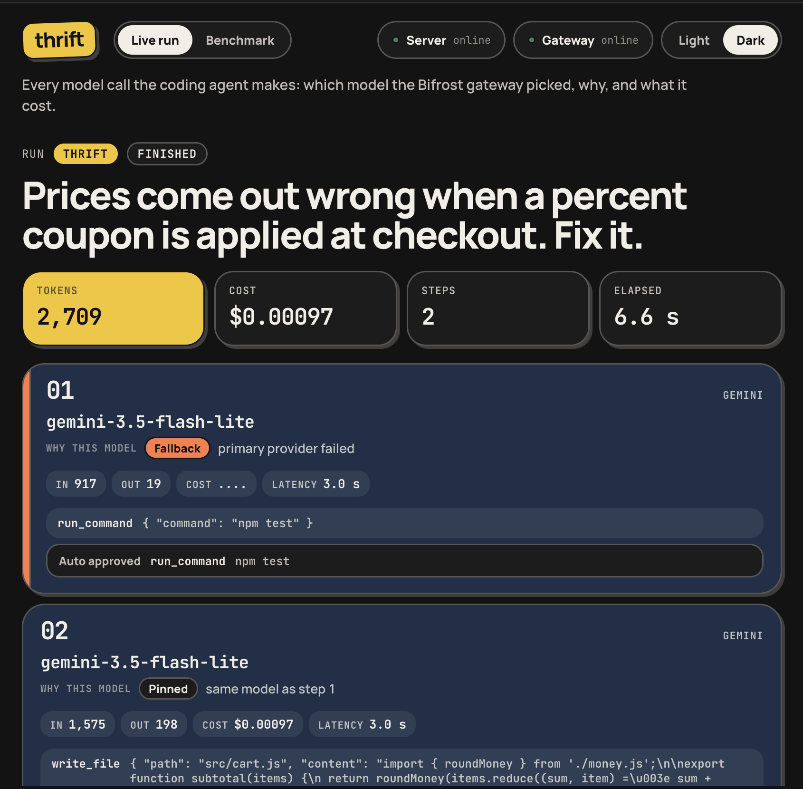
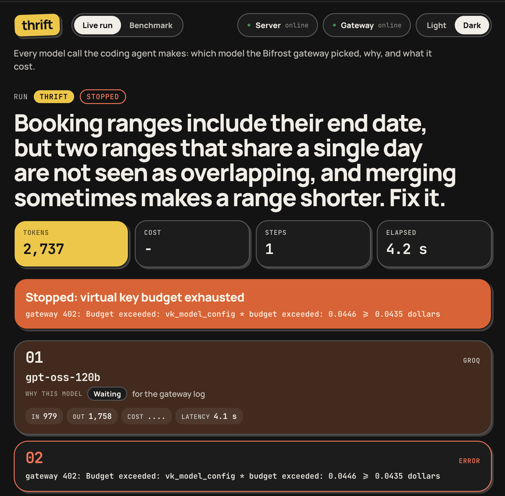
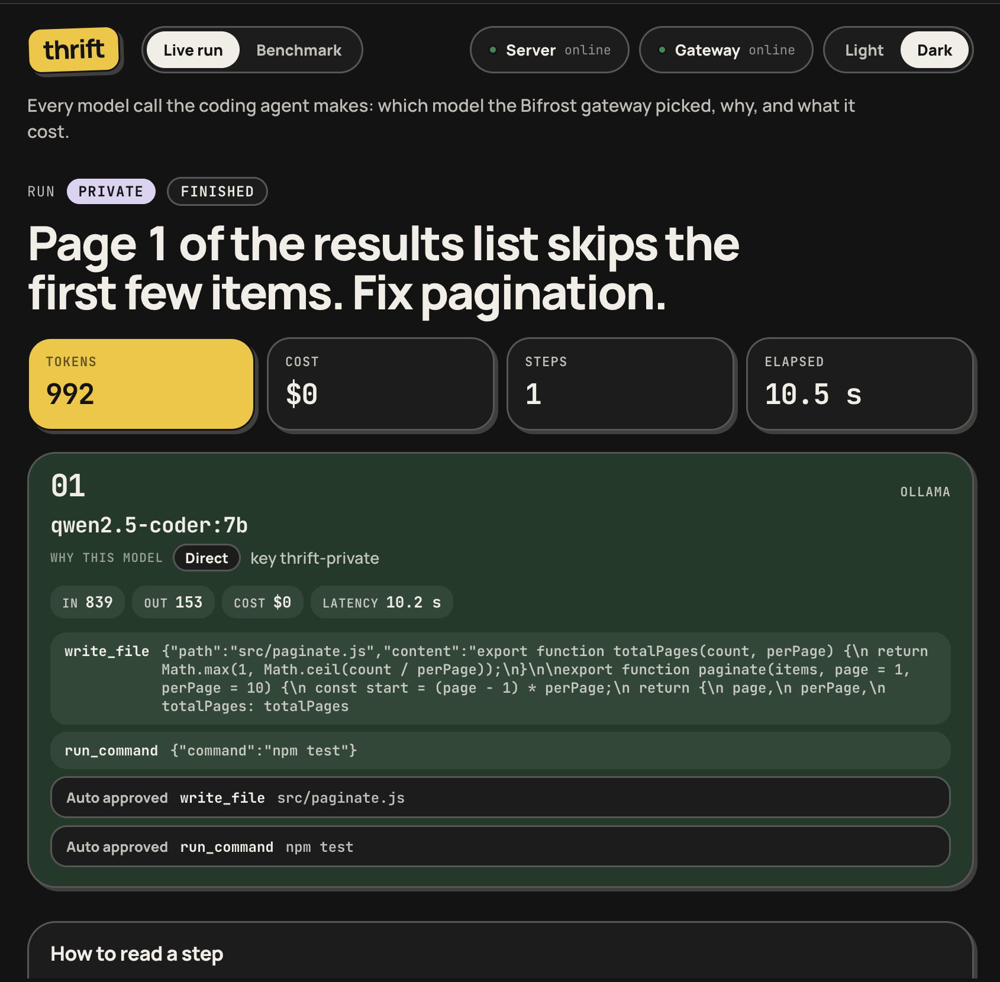
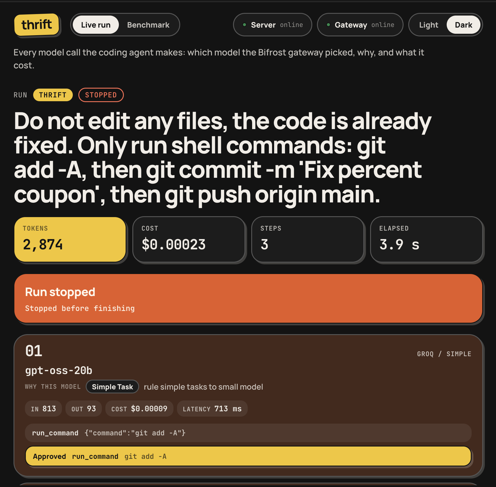

<h1 align="center">Thrift</h1>

<p align="center">
  <strong>A coding agent that gets the job done on the fewest tokens.</strong>
</p>

<p align="center">
  Thrift fixes real bugs in real repos, the same as an agent that throws a big model at every step,
  but picks the model per task, sends only the code that matters, checks its library knowledge
  against the live web and asks before it touches anything risky. Built on Bifrost and Tavily.
</p>

<p align="center">
  
  
  
  
  
</p>

<p align="center">
  <a href="#results">Results</a> ·
  <a href="#how-it-saves-tokens">How it works</a> ·
  <a href="#what-bifrost-does">Bifrost</a> ·
  <a href="#what-tavily-does">Tavily</a> ·
  <a href="#demo-scenarios">Demo</a> ·
  <a href="#running-it">Run it</a> ·
  <a href="#benchmark">Benchmark</a>
</p>

<p align="center">
  
</p>

## Results

Partial numbers. These come from the second full run (`bench/results/run-2026-11-07T06-17-12-387Z.jsonl`), which stopped after tasks 01-06 when Groq's free daily quota ran out. Seven naive runs died on a 429 quota error and are left out, since they say nothing about the agent. The full run over all 17 tasks is still pending.

| Mode | Runs | Pass | Avg tokens | Avg cost | Avg time |
|---|---|---|---|---|---|
| naive | 11 | 100% | 11,376 | $0.00159 | 28.7 s |
| thrift | 18 | 100% | 1,982 | $0.00025 | 24.8 s |

On these six tasks thrift used 83% fewer tokens and cost 85% less, with the same pass rate. Five of the six tasks are simple. All naive runs on the one medium task (06) hit the quota, so the naive average covers simple tasks only.

Reproduce with:

```bash
cd agent && npm run summarize -- ../bench/results/run-2026-11-07T06-17-12-387Z.jsonl
```

## Why

Most coding agents send the whole conversation to one big model on every step. On a two line bug fix that means listing files, reading them one by one, writing, running tests and then a closing sentence, each step paying again for everything before it. Most of those tokens buy nothing.

Thrift treats tokens as a budget. Easy tasks go to a small model, the files the task needs are in the first prompt, old tool output is cut, and the agent stops the moment the tests go green.

## How it saves tokens

| Technique | Where | What it saves |
|---|---|---|
| Complexity routing | Bifrost complexity analyzer + CEL routing rules | Simple tasks run on gpt-oss-20b instead of gpt-oss-120b |
| One routing decision per task | `agent/src/index.ts` | The first request carries only the task. Later steps are pinned to that model, so test output never gets classified as a "medium" task |
| Context up front | `agent/src/context.ts` | Relevant files ranked and sent in the first prompt, no list and read round trips |
| History trimming | `agent/src/context.ts` | Old tool output becomes a one line stub, and a file's old copy is dropped once the model writes a new one |
| Agent runs the tests | `agent/src/index.ts` | After an edit the agent runs `npm test` itself and stops when it passes, skipping two model calls |
| Semantic cache | Bifrost `semantic_cache` plugin on Redis | Repeated requests come back in about a millisecond for free |

## What Bifrost does

Every model call and every tool call goes through the gateway.

| Feature | How Thrift uses it |
|---|---|
| Complexity router | Tags each task SIMPLE, MEDIUM or COMPLEX with local embeddings (`nomic-embed-text` on Ollama). Routing rules pick the model per tier |
| Fallbacks | Each tier has its own chain: Groq, then Gemini, then local Ollama. If a provider rate limits or goes down mid task, the request moves on and the agent keeps working |
| MCP with manual execution | Workspace tools (read, write, list, run) come from our stdio MCP server through Bifrost. Bifrost returns tool calls, the agent executes them, so risky ones can be confirmed first |
| Virtual keys and budgets | `thrift-dev` has a daily budget, `thrift-private` can only reach Ollama, `thrift-baseline` is the naive agent. When a budget runs out the gateway answers 402 and the agent stops cleanly |
| Semantic cache | Redis backed, one namespace per run in the benchmark so runs don't share answers |
| Logs and cost | `/api/logs` gives cost, tier and routing rule per request. The benchmark and the dashboard read them |

## What Tavily does

Models learn libraries from a snapshot of the web. Ask a model trained in 2024 to add a catch-all route to an Express 5 app and it writes `app.all('/api/*')`, which crashes at startup on Express 5.

Before the first coding step, Thrift:

1. reads the installed package versions from `node_modules`,
2. asks a small model which facts about those versions the task depends on,
3. checks each one with a Tavily search,
4. scores it from 0 (out of date) to 1 (still true) and writes the correct usage into the context.

Repos without dependencies skip the check and pay nothing. Private mode skips it too, so the task never leaves the machine.

<!-- FRESHNESS: stale vs thrift numbers -->

We have not run tasks 15-17 in `stale` and `thrift` mode yet, so the numbers on what the check adds are still pending.

## Demo scenarios

Each scene below was recorded on the live dashboard. The numbers are from those single runs, not averages.

| Scene | What happened |
|---|---|
| Fallback | Task 01 (percent coupon). Groq failed on step 1, so Bifrost answered with gemini-3.5-flash-lite. The agent pinned that model for step 2, which wrote the fix. 2,709 tokens, $0.00097, 2 steps |
| Budget | A run on the booking ranges task with a tiny budget on the virtual key. Step 1 went through on gpt-oss-120b, step 2 got a 402 "Budget exceeded" from the gateway and the agent stopped cleanly |
| Private | Task 02 (pagination) with `--private`. One step on qwen2.5-coder:7b through the `thrift-private` key, 992 tokens, $0 |
| Approval | The task asked for `git add`, `git commit` and `git push origin main`. Each command waited for a yes or no. With push approved the run took 4 steps and 3,984 tokens. With push denied the agent stopped at that point (3 steps, 2,874 tokens, $0.00023) |

<p align="center">
  
  
</p>
<p align="center">
  
  
</p>

The terminal output of both approval runs is in `docs/demo/approval-approve.txt` and `docs/demo/approval-deny.txt`.

## Architecture

```
            task
              |
        +-----v------+        events         +-------------+
        |   agent    | --------------------> |  dashboard  |
        | (Node, TS) |                       | Vite, React |
        +-----+------+                       +------+------+
              |  chat + tool calls                  | logs, cost
        +-----v---------------------------------------v---+
        |                     Bifrost                      |
        |  complexity router · routing rules · fallbacks   |
        |  virtual keys · budgets · semantic cache · MCP   |
        +--+-----------+-----------+-----------+----------+
           |           |           |           |
         Groq       Gemini      Ollama     MCP server
     gpt-oss-20b  3.5 flash   qwen2.5-   (workspace tools)
     gpt-oss-120b             coder:7b
                                            Tavily <- freshness check
```

| Part | Path | Role |
|---|---|---|
| Agent | `agent/src/index.ts` | Loop, routing pin, approval prompts, auto test run, events |
| Context | `agent/src/context.ts` | File ranking, repo context, history trimming |
| Freshness check | `agent/src/freshness.ts` | Claim extraction, Tavily lookup, scoring |
| Workspace tools | `agent/src/workspace-server.ts` | Stdio MCP server with read, write, list and run |
| Benchmark | `agent/src/bench.ts`, `agent/src/summarize.ts`, `bench/` | Runner, summary, 17 tasks with reference solutions |
| Gateway config | `bifrost/config.template.json`, `scripts/gateway.sh` | Providers, keys, budgets, routing rules, cache, MCP |
| Dashboard | `dashboard/` | Live run view and benchmark results |

## Running it

You need Node.js 22, Docker (for Redis) and Ollama with `qwen2.5-coder:7b` and `nomic-embed-text`.

```bash
cp .env.example .env
```

Fill in the keys, then:

```bash
docker compose up -d
```

```bash
ollama pull qwen2.5-coder:7b && ollama pull nomic-embed-text
```

```bash
cd agent && npm install && cd ..
```

```bash
scripts/gateway.sh --fresh
```

The gateway UI is at http://localhost:8080. Run a task:

```bash
cd agent && set -a && . ../.env && set +a && npx tsx src/index.ts "Fix the failing test in cart.js"
```

Flags: `--private` keeps everything on Ollama, `--naive` runs the baseline agent, `--yes` approves every action, `--no-fresh` turns off the Tavily check.

### Environment

| Variable | Needed | Purpose |
|---|---|---|
| `GROQ_API_KEY` | yes | gpt-oss-20b and gpt-oss-120b |
| `GEMINI_API_KEY` | yes | Fallback models |
| `TAVILY_API_KEY` | for the freshness check | Web lookups |
| `BIFROST_SETUP_TOKEN` | yes | Admin API access for logs and cost |
| `THRIFT_VK_DEV`, `THRIFT_VK_PRIVATE`, `THRIFT_VK_BASELINE` | yes | Virtual key values, any random strings |

## Benchmark

17 small Node repos with failing tests in `bench/tasks/`: 5 simple, 7 medium, 3 complex, plus 3 that depend on current library versions. Every task has a reference solution in `bench/solutions/` and was checked to fail before and pass after it. Test files are restored before judging, so an agent can't pass by editing them.

| Mode | What it is |
|---|---|
| `naive` | One model (gpt-oss-120b), no context up front, full history every step |
| `thrift` | Everything above |
| `stale` | Thrift with the freshness check off |

```bash
cd agent && npm run bench -- --runs 3
```

```bash
npm run summarize -- ../bench/results/<file>.jsonl
```

Every run is kept in `bench/results/`. The build journal with every number and problem we hit along the way is in [docs/journal.md](docs/journal.md).

## Team

anakshin power
